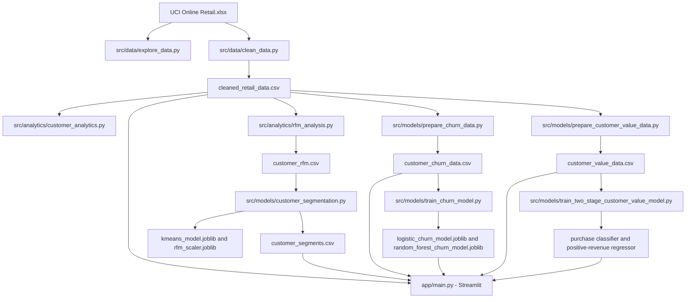

# System Architecture

## Overview

The project is a local, file-based analytics workflow. Python scripts transform the UCI Online Retail workbook into transaction and customer datasets, train analytical models, and write CSV and joblib artifacts under `data/processed/`. The Streamlit application reads those artifacts and presents the results through four dashboard pages.

## Component Diagram



## Main Components

| Component                     | Responsibility                                                                                                     |
| ----------------------------- | ------------------------------------------------------------------------------------------------------------------ |
| `data/raw/Online Retail.xlsx` | Source workbook expected by the cleaning and exploration scripts.                                                  |
| `src/data/clean_data.py`      | Cleans transaction records, calculates line revenue, and writes the canonical transaction CSV.                     |
| `src/analytics/`              | Produces business summaries and RFM customer metrics.                                                              |
| `src/models/`                 | Builds customer datasets, fits segmentation and predictive models, and runs evaluation/reporting scripts.          |
| `data/processed/`             | Stores generated data, serialized models, and evaluation reports consumed by downstream scripts and the dashboard. |
| `app/main.py`                 | Loads the cleaned transactions and page-specific artifacts, then renders the Streamlit application.                |

## Data and Model Flow

1. Cleaning reads the workbook, removes incomplete customer or description records, cancellations, and nonpositive quantity or price lines, and calculates `Revenue = Quantity * UnitPrice`.
2. Business and RFM scripts aggregate cleaned transactions. The segmentation script log-transforms Frequency and Monetary, standardizes the three RFM dimensions, and fits four-cluster K-Means.
3. Churn preparation builds observation-window customer features and a label based on purchases in a later window. The training script fits logistic-regression and random-forest pipelines.
4. Customer-value preparation calculates historical customer features and future-period revenue. The two-stage training script fits a purchase classifier and a log-revenue regressor on positive-revenue observations.
5. The Streamlit app loads the resulting CSV and joblib files. It selects inference columns using each fitted estimator's feature names where available.

## Generated Artifacts

Main dashboard inputs and related artifacts include:

- `cleaned_retail_data.csv`
- `customer_rfm.csv`, `customer_segments.csv`, `kmeans_model.joblib`, and `rfm_scaler.joblib`
- `customer_churn_data.csv`, `logistic_churn_model.joblib`, and `random_forest_churn_model.joblib`
- `customer_value_data.csv`, `customer_purchase_classifier.joblib`, and `customer_positive_revenue_model.joblib`
- Evaluation and report CSVs such as `customer_value_temporal_validation.csv` and `two_stage_customer_value_results.csv`

These are generated files, not independent source code. If upstream data or feature logic changes, regenerate the dependent datasets and retrain corresponding models before using the dashboard.

## Run the Application

From the repository root, install dependencies and start the app:

```bash
python -m pip install -r requirements.txt
python -m streamlit run app/main.py
```

The required dataset and model artifacts must already exist in `data/processed/`. See the repository README for the full preparation and training sequence.

## Operational Notes

- The project uses local files; the current app has no database or remote service integration.
- `joblib` model artifacts should only be loaded from trusted sources.
- The project is an educational historical analysis, not a production scoring service.
